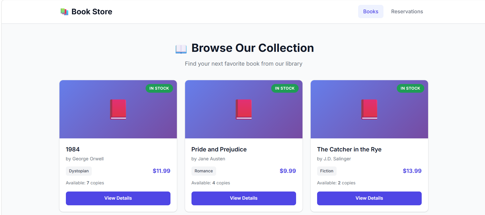
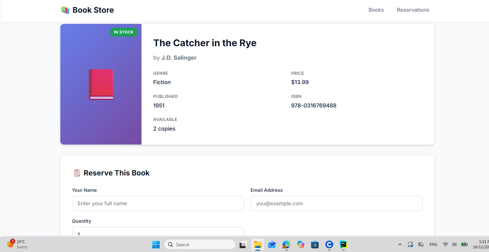
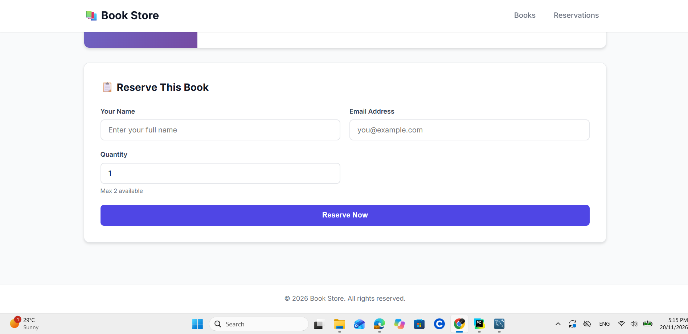

## Book Reservation System

A web-based Book Reservation System designed to simplify library operations and improve the book borrowing experience. The system provides an organized platform for managing books, handling reservations, and tracking borrowing activities.

## Project Overview

The Book Reservation System aims to digitize traditional library reservation processes by providing an easy-to-use interface for users and administrators.

Users can explore available books, make reservations, and manage their borrowing activities, while administrators can manage the book collection and monitor reservations.

## Key Features

### User Features
User registration and authentication.
Browse available books.
Search for books by title or category.
View book details and availability.
Reserve available books.
View personal reservations.
Manage reservation information.

### Administrator Features
Admin authentication.
Add new books to the collection.
Update existing book information.
Delete books from the system.
Manage user reservations.
Monitor book availability.
Manage library records.

## Technologies Used

Frontend: HTML5, CSS3, JavaScript
Backend: [Flask Python Framework]
Database: [MySQL]
Version Control: Git & GitHub
Tools: PyCharm 

## Screenshots
markdown





## Future Improvements
Email notifications for reservations.
Advanced book search and filtering.
Book return tracking.
Reservation history.
QR code integration.
Advanced reporting and analytics.
Improved security and role-based access control.

## Setup

### Prerequisites

- Python 3.8+
- MySQL server running with the `library_db` database

### Installation

1. **Install dependencies:**
   ```bash
   pip install -r requirements.txt
   ```

2. **Configure database:**

   Copy `.env.example` to `.env` and edit with your MySQL credentials:
   ```
   DB_HOST=localhost
   DB_USER=root
   DB_PASSWORD=your_password
   DB_NAME=library_db
   ```

3. **Set up the database:**

   Run the schema file to create tables and sample data:
   ```bash
   mysql -u root -p < schema.sql
   ```

4. **Run the application:**

   **Development:**
   ```bash
   python app.py
   ```

   **Production (with Gunicorn):**
   ```bash
   gunicorn -c gunicorn_config.py app:app
   ```

5. **Open in browser:**

   - Development: `http://127.0.0.1:5000`
   - Production: `http://localhost:8000`

## Production Deployment

For production, use **Gunicorn** as the WSGI server:

```bash
gunicorn -c gunicorn_config.py app:app
```

The app will run on `0.0.0.0:8000` with 4 worker processes.

## Author

MOSAB ABAKAR

GitHub: @MOSAB-ABAKAR
🤝 Contributing

Contributions, suggestions, and improvements are welcome.

## License

The project is for educational purposes and to test the advantages of the Flask framework. 
⭐ If you find this project useful, consider giving it a star!
